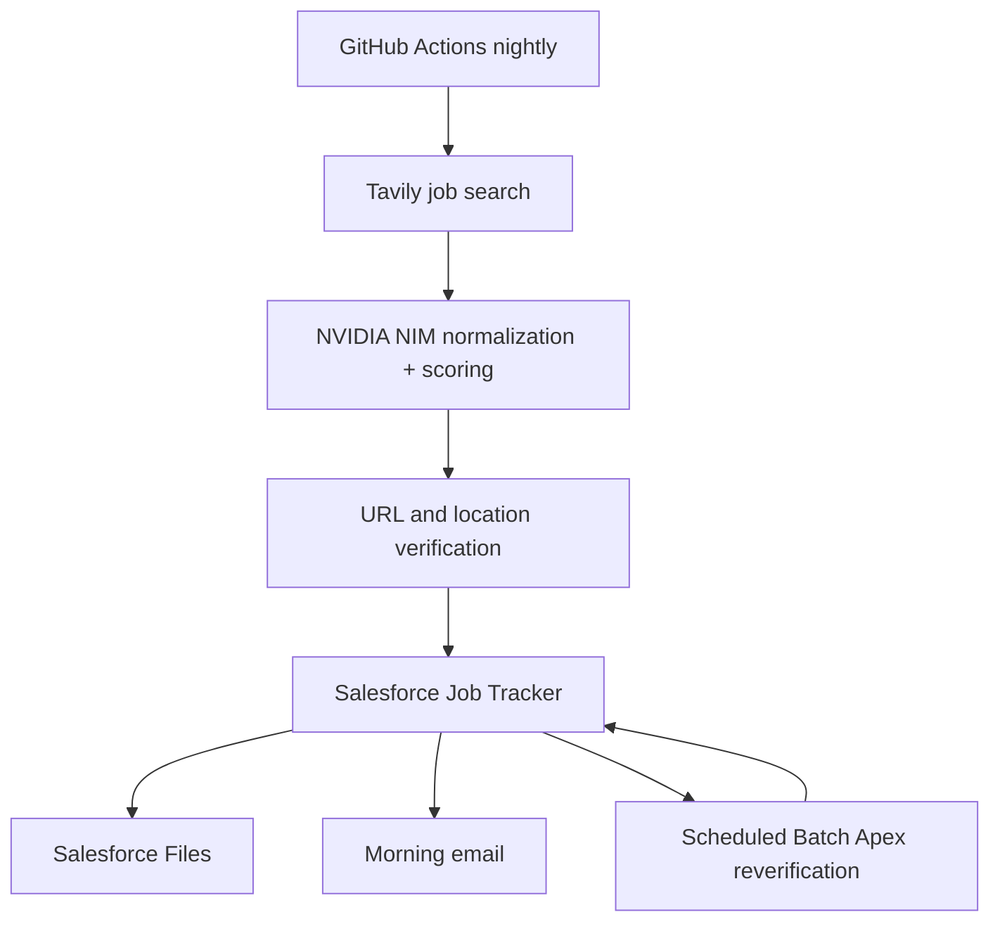

# Salesforce Job Search Agent

Nightly cloud automation for Salesforce Admin/Developer job searches. Tavily finds current postings, NVIDIA NIM evaluates them, GitHub Actions runs discovery, and Salesforce manages the saved jobs and their ongoing lifecycle.

## What it does

- Searches for Salesforce Administrator, Senior Salesforce Administrator, Salesforce Developer, and Senior Salesforce Developer openings.
- Includes remote, hybrid, and onsite roles anywhere in the United States and rejects international or ambiguous locations; location remains available as a Salesforce reporting and list-view filter.
- checks posting URLs and rejects pages that appear closed, expired, or unavailable.
- scores each job against your supplied resume without inventing experience.
- classifies explicit sponsorship language as Available, Not Available, or Unknown and stores it for Salesforce filtering.
- upserts the best jobs into `Job_Application__c` by canonical URL hash.
- attaches the same master resume, `resumes/resume.pdf`, to every record.
- creates and attaches a truthful tailored Markdown resume for the strongest match.
- invokes Salesforce Apex to email a morning digest.

## Architecture



## Prerequisites

- A Salesforce org with My Domain enabled.
- Salesforce CLI (`sf`) for the one-time metadata deployment.
- A private GitHub repository.
- An NVIDIA NIM API key and a Tavily API key.
- Your factual master resume in PDF and text format.

## 1. Deploy Salesforce metadata

```bash
sf org login web --alias JobSearchOrg
sf project deploy start --target-org JobSearchOrg
sf org assign permset --name Job_Search_Agent_Admin --target-org JobSearchOrg
```

Open App Launcher → **Job Search Tracker** after deployment.

### Schedule Salesforce reverification

After deployment, open **Setup → Developer Console → Debug → Open Execute Anonymous Window** and run:

```apex
JobPostingReverificationScheduler.scheduleDaily(7);
```

This schedules Salesforce to recheck saved open postings every day at 7:00 AM in the org's configured time zone. Confirm it under **Setup → Scheduled Jobs**. Run this statement only once; running it again creates another scheduled job.

The batch processes 20 records per transaction. Confirmed `404`, `410`, or explicit closed-posting pages set `Verified Open` to false. Records in `Discovered` or `Reviewing` also move to `Closed`. Applied and Interviewing records retain their status. Ambiguous responses such as `403` remain unchanged.

## 2. Create Salesforce server-to-server authentication

Salesforce restricts creation of legacy Connected Apps beginning Spring '26, so use an **External Client App**:

1. Setup → External Client App Manager → New External Client App.
2. Enable OAuth and select **Manage user data via APIs (`api`)**.
3. Enable **Client Credentials Flow**.
4. Set **Permitted Users** to admin-approved users.
5. Set the Run As user to a dedicated Salesforce Integration user.
6. Assign `Job_Search_Agent_Integration` to that user.
7. Copy the consumer key and secret into GitHub secrets; never commit them.

## 3. Add your resume

Place the files below in this private repository:

```text
resumes/resume.pdf
resumes/resume.txt
```

The PDF is attached to every Salesforce job record. The `.txt` version is used for matching and tailoring and must contain the same factual content as the PDF.

## 4. Add GitHub Actions secrets and variables

Repository → Settings → Secrets and variables → Actions.

Secrets:

- `NVIDIA_API_KEY`
- `TAVILY_API_KEY`
- `SF_CLIENT_ID`
- `SF_CLIENT_SECRET`

Variables:

- `SF_LOGIN_URL` — normally `https://your-domain.my.salesforce.com`
- `NVIDIA_MODEL` — use `nvidia/nemotron-3.5-lightning-30b-a3b`
- `SUMMARY_EMAIL` — fallback email if Salesforce setting is blank
- `MINIMUM_SCORE` — default `70`
- `MAXIMUM_JOBS` — default `10`
- `POSTED_WITHIN_DAYS` — default `3`; postings without a verifiable date are rejected

The workflow runs at 5:30 AM America/New_York on weekdays and can also be started manually. Change the schedule in `.github/workflows/nightly-job-search.yml` if desired.

## 5. Test safely

Run the workflow manually with `dry_run=true`. It searches, verifies, and scores jobs but does not write to Salesforce or send email. Review the Actions log, then run again with `dry_run=false`.

## Security and operating notes

- Keep the repository private because it contains your resumes.
- NVIDIA NIM receives a text version of the resume with common email and phone patterns removed. Tavily never receives the resume.
- The free trial endpoints have quotas and rate limits. This workflow uses three basic Tavily searches per run and limits model output sizes.
- Use an API-only integration user with only the supplied permission set.
- URLs are canonicalized and hashed, preventing duplicates across runs.
- Existing application statuses are preserved during nightly refreshes, and resume files are not attached twice.
- General job collections and aggregator pages are rejected; only individual employer or ATS postings are eligible.
- LinkedIn is not scraped or accessed by automation. LinkedIn blocks unauthorized automated access, so the search favors the corresponding employer or ATS application page when the same opening is advertised there.
- Only active postings dated within the configured three-day window are eligible.
- Salesforce stores verified active jobs posted within the last three days.
- Morning summaries contain only newly created records whose posting date is today; older and refreshed records are not repeated.
- AI output is treated as untrusted input and validated before Salesforce writes.
- The URL check is best-effort. Some job sites block automated requests; those results are rejected unless the page can be verified.
- Job-board terms vary. This implementation uses web search results and employer/ATS pages; it does not log into or scrape LinkedIn.

## Local validation

```bash
npm install
npm test
NVIDIA_API_KEY=... TAVILY_API_KEY=... SF_CLIENT_ID=... SF_CLIENT_SECRET=... \
SF_LOGIN_URL=https://your-domain.my.salesforce.com npm run dry-run
```
