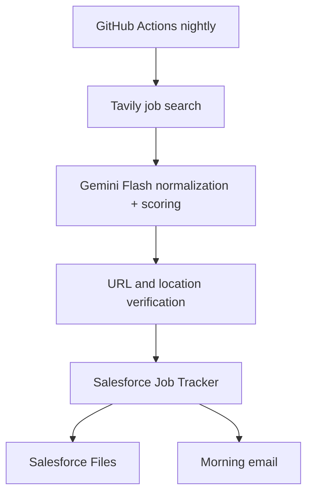

# Salesforce Job Search Agent

Nightly cloud automation for Salesforce Admin/Developer job searches. Tavily finds current postings, Gemini Flash evaluates them, GitHub Actions runs the process, and Salesforce remains the system of record.

## What it does

- Searches for Salesforce Administrator, Senior Salesforce Administrator, Salesforce Developer, and Senior Salesforce Developer openings.
- Keeps only nationwide remote-US, DC/DMV, or Atlanta-metro roles.
- checks posting URLs and rejects pages that appear closed, expired, or unavailable.
- scores each job against your supplied resume without inventing experience.
- upserts the best jobs into `Job_Application__c` by canonical URL hash.
- attaches the same master resume, `resumes/resume.pdf`, to every record.
- creates and attaches a truthful tailored Markdown resume for the strongest match.
- invokes Salesforce Apex to email a morning digest.

## Architecture



## Prerequisites

- A Salesforce org with My Domain enabled.
- Salesforce CLI (`sf`) for the one-time metadata deployment.
- A private GitHub repository.
- A Google AI Studio Gemini API key and a Tavily API key.
- Your factual master resume in PDF and text format.

## 1. Deploy Salesforce metadata

```bash
sf org login web --alias JobSearchOrg
sf project deploy start --target-org JobSearchOrg
sf org assign permset --name Job_Search_Agent_Admin --target-org JobSearchOrg
```

Open App Launcher → **Job Search Tracker** after deployment.

## 2. Create Salesforce server-to-server authentication

Salesforce restricts creation of legacy Connected Apps beginning Spring '26, so use an **External Client App**:

1. Setup → External Client App Manager → New External Client App.
2. Enable OAuth and select **Manage user data via APIs (`api`)**.
3. Enable **Client Credentials Flow**.
4. Set **Permitted Users** to admin-approved users.
5. Set the Run As user to a dedicated Salesforce Integration user.
6. Assign `Job_Search_Agent_Integration` to that user.
7. Copy the consumer key and secret into GitHub secrets; never commit them.

## 3. Add your resume

Place the files below in this private repository:

```text
resumes/resume.pdf
resumes/resume.txt
```

The PDF is attached to every Salesforce job record. The `.txt` version is used for matching and tailoring and must contain the same factual content as the PDF.

## 4. Add GitHub Actions secrets and variables

Repository → Settings → Secrets and variables → Actions.

Secrets:

- `GEMINI_API_KEY`
- `TAVILY_API_KEY`
- `SF_CLIENT_ID`
- `SF_CLIENT_SECRET`

Variables:

- `SF_LOGIN_URL` — normally `https://your-domain.my.salesforce.com`
- `GEMINI_MODEL` — use `gemini-3.6-flash`
- `SUMMARY_EMAIL` — fallback email if Salesforce setting is blank

The workflow runs at 5:30 AM America/New_York on weekdays and can also be started manually. Change the schedule in `.github/workflows/nightly-job-search.yml` if desired.

## 5. Test safely

Run the workflow manually with `dry_run=true`. It searches, verifies, and scores jobs but does not write to Salesforce or send email. Review the Actions log, then run again with `dry_run=false`.

## Security and operating notes

- Keep the repository private because it contains your resumes.
- Gemini receives a text version of the resume with common email and phone patterns removed. Tavily never receives the resume.
- The free tiers have quotas and rate limits. This workflow uses three basic Tavily searches per run and limits Gemini output sizes.
- Use an API-only integration user with only the supplied permission set.
- URLs are canonicalized and hashed, preventing duplicates across runs.
- AI output is treated as untrusted input and validated before Salesforce writes.
- The URL check is best-effort. Some job sites block automated requests; those results are rejected unless the page can be verified.
- Job-board terms vary. This implementation uses web search results and employer/ATS pages; it does not log into or scrape LinkedIn.

## Local validation

```bash
npm install
npm test
GEMINI_API_KEY=... TAVILY_API_KEY=... SF_CLIENT_ID=... SF_CLIENT_SECRET=... \
SF_LOGIN_URL=https://your-domain.my.salesforce.com npm run dry-run
```
